<p align="center">
  
</p>

<h1 align="center">Território Vivo</h1>

<p align="center">
  <b>A central de decisões de quem cuida do território: indicadores, previsões e alertas explicados — com a decisão final sempre humana.</b>
</p>

<p align="center">
  Flutter 3.35 · Dart 3.9 · Android / iOS / Web · Global Solution 2026.2 — CitizenTech · Territory Predictive Insights
</p>

---

## 2. Problema e público

**Território:** Zona Leste de São Paulo — cinco subprefeituras (Itaquera, São Mateus, Guaianases, Cidade Tiradentes e Penha), cerca de **1,9 milhão de habitantes**, com histórico de alagamentos em várzeas, ilhas de calor, poluição do ar e alta demanda por serviços públicos.

**Problema que o app antecipa:** gestores costumam reagir *depois* que o problema aparece (rua alagada, UBS lotada, vazamento que dura dias). O Território Vivo cruza dados de clima, qualidade do ar, consumo de água e energia, coleta de resíduos e demanda nas UBS para **sinalizar com antecedência**:

| Situação antecipada | Exemplo no app |
|---|---|
| Onda de calor | 3+ dias previstos acima de 32 °C → preparar pontos de hidratação |
| Chuva forte / alagamento | > 30 mm/dia previstos → limpeza preventiva de bocas de lobo |
| Ar inadequado | PM2,5 acima do limiar → comunicado a grupos sensíveis |
| Desperdício de água | consumo 15% acima do esperado → possível vazamento |
| Falha de serviço | coleta de resíduos caindo → risco de lixo acumulado |
| Pressão na saúde | demanda prevista nas UBS +17% → remanejar equipes |

**Para quem:**
- **Gestores públicos** (subprefeituras, Defesa Civil, saúde, zeladoria): acompanham painéis, avaliam alertas e **registram a decisão com justificativa**.
- **Cidadãos**: entendem os alertas em linguagem simples e **relatam ocorrências de forma anônima**, que viram evidência complementar.

**Impacto social esperado:** menos perdas de água, resposta mais rápida a calor e alagamento, melhor distribuição de equipes de saúde e transparência sobre *por que* cada alerta existe. O app mostra esse impacto em indicadores próprios (seção [Dados e alertas](#6-dados-e-alertas)).

## 3. Integrantes

| Nome completo | RM |
|---|---|
| _Preencher_ | _RM00000_ |
| _Preencher_ | _RM00000_ |
| _Preencher_ | _RM00000_ |

## 4. Demonstração visual

> Prints reais do app (build web, viewport de celular 412 px), com dados ao vivo da Open-Meteo em 05/11/2026. Todas as imagens estão em [`assets/screenshots/`](assets/screenshots/).

| | | |
|:---:|:---:|:---:|
| 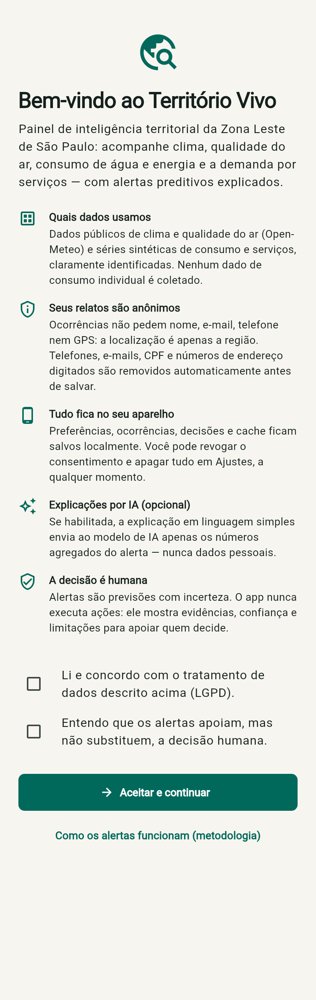<br>**Consentimento (LGPD)** — termos claros e duas confirmações obrigatórias | 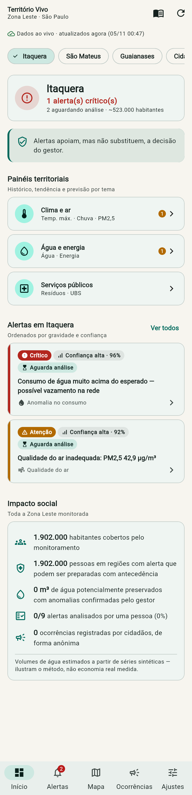<br>**Visão geral** — status da região, painéis, alertas e impacto social | 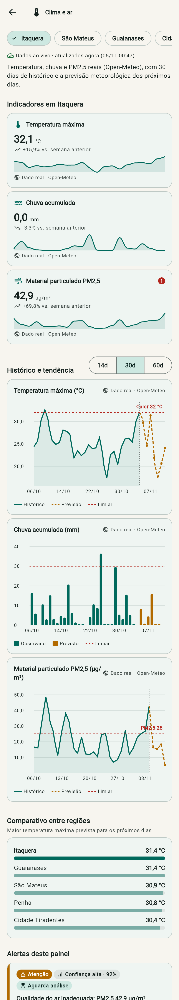<br>**Dashboard Clima e ar** — dados reais + previsão meteorológica |
| 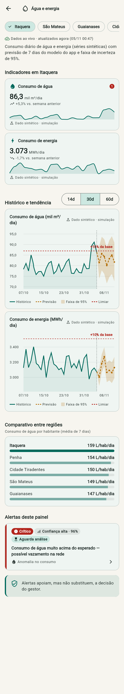<br>**Dashboard Água e energia** — previsão de 7 dias com faixa de 95% | 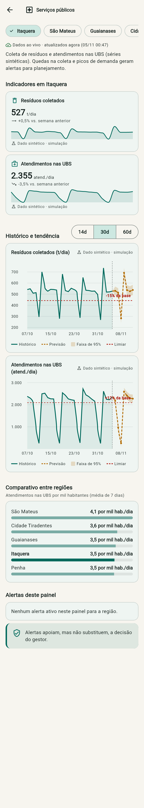<br>**Dashboard Serviços** — resíduos e UBS, comparativo entre regiões | 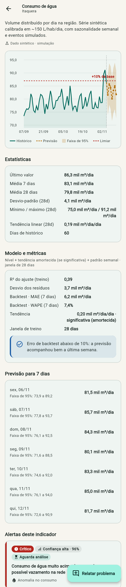<br>**Detalhe do indicador** — estatísticas, métricas de backtest e previsão |
| 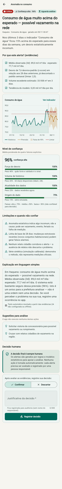<br>**Detalhe do alerta** — evidências, confiança, limitações e explicação simples | 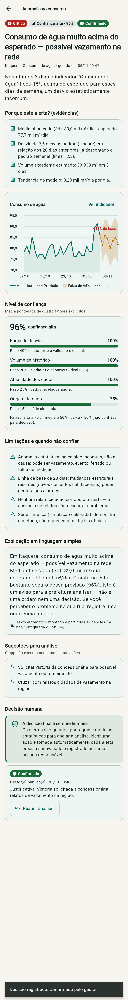<br>**Decisão humana registrada** — com justificativa e opção de reabrir | 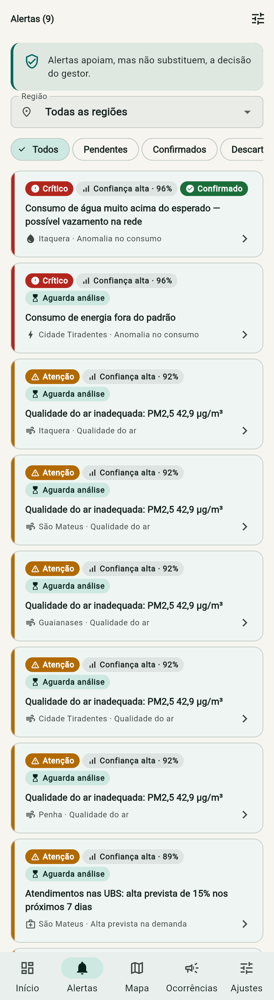<br>**Lista de alertas** — filtros por região, gravidade e situação |
| 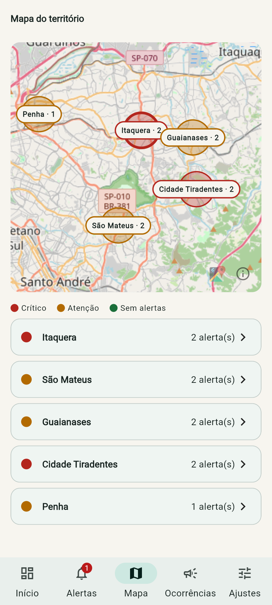<br>**Mapa** — regiões coloridas pelo alerta mais grave + lista acessível | 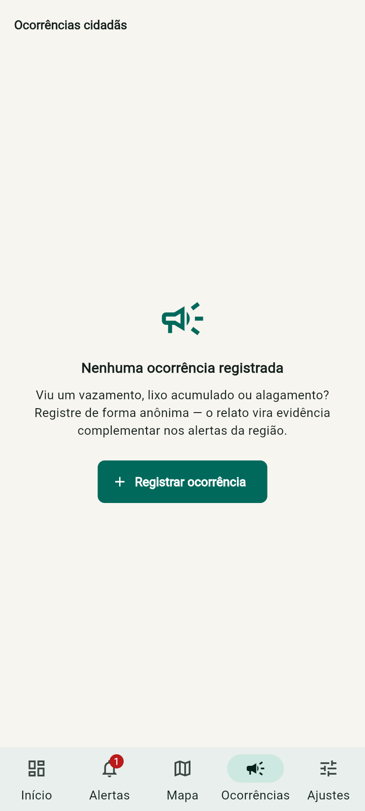<br>**Ocorrências (lista vazia)** — estado vazio com chamada para ação | 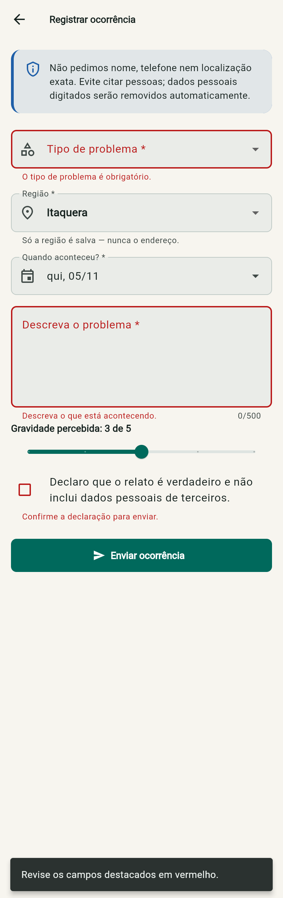<br>**Formulário — validação** — mensagens de erro claras por campo |
| 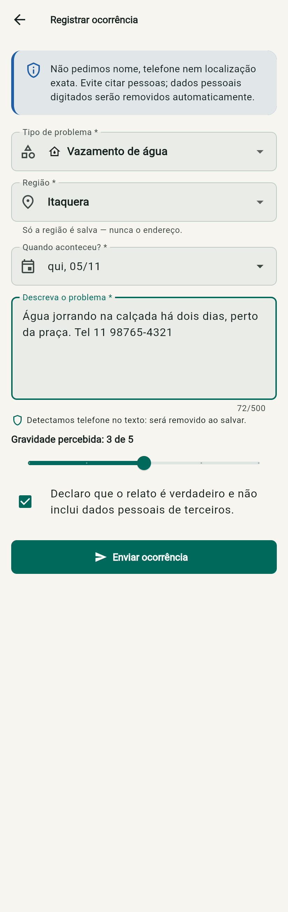<br>**Formulário preenchido** — detecção de dado pessoal em tempo real | 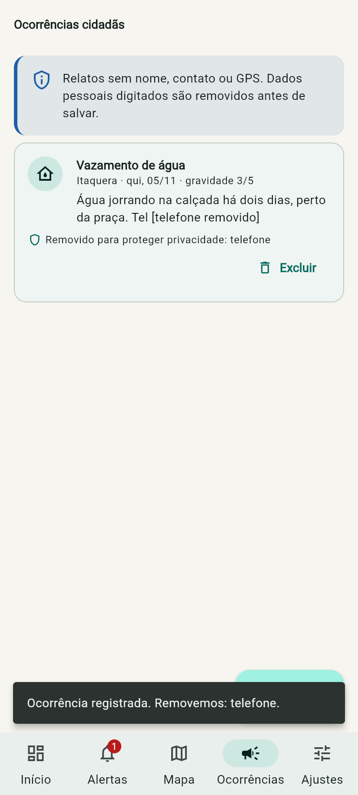<br>**Ocorrência salva** — telefone removido automaticamente | 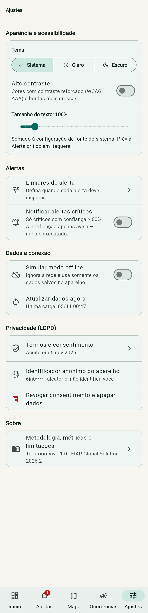<br>**Ajustes** — tema, alto contraste, fonte, offline e privacidade |
| 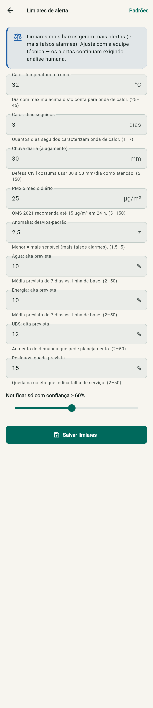<br>**Limiares de alerta** — formulário validado e persistido | 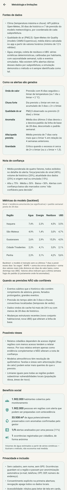<br>**Metodologia** — regras, confiança, backtest, vieses e limites | 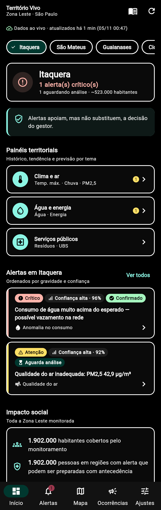<br>**Tema escuro + alto contraste** |

## 5. Funcionalidades

**Navegação e fluxo**
- [x] 12 telas com **rotas nomeadas** (`AppRoutes`) e **argumentos tipados** (`IndicatorArgs`, `AlertArgs`, `AlertsArgs`, `OccurrenceFormArgs`)
- [x] Fluxo coerente: visão geral → dashboard → detalhe do indicador → detalhe do alerta → decisão humana
- [x] Navegação inferior com 5 áreas (Início, Alertas, Mapa, Ocorrências, Ajustes) e badge de alertas críticos pendentes

**Dashboards territoriais**
- [x] 3 dashboards distintos: **Clima e ar**, **Água e energia**, **Serviços públicos**
- [x] Cards de KPI com valor atual, variação semanal, minigráfico e origem do dado
- [x] Gráficos de linha (histórico + previsão tracejada + faixa de 95% + limiar) e de barras (chuva)
- [x] Janela de 14/30/60 dias e comparativo entre as 5 regiões

**Alertas preditivos e transparência**
- [x] 6 tipos de alerta gerados por regras e modelos estatísticos
- [x] Cada alerta mostra **evidência numérica, nota de confiança com 4 fatores, limitações, sugestões** e explicação em linguagem simples
- [x] Aviso visível de que **os alertas apoiam, mas não substituem, a decisão humana**
- [x] Decisão humana obrigatória com justificativa (confirmar/descartar), persistida e reversível
- [x] Previsões com confiança < 50% marcadas como **não confiáveis para decisão**

**Estado, dados e persistência**
- [x] Estado global (Provider) compartilhado por várias telas; estado local para filtros, abas e formulários
- [x] Carregamento, erro e lista vazia tratados em todas as telas com dados
- [x] **API pública real** (Open-Meteo: clima e qualidade do ar) + **serviço simulado** com latência e JSON
- [x] Persistência local de cache, ocorrências, decisões, limiares, preferências e consentimento
- [x] **Funciona sem conexão** (cache + modo offline simulável), com aviso da idade dos dados

**Formulários**
- [x] Registro de ocorrência cidadã com validação, erros por campo e anonimização
- [x] Configuração de limiares de alerta com validação de faixa
- [x] Formulário de decisão humana com justificativa obrigatória

**Qualidade, acessibilidade e privacidade**
- [x] Tema próprio com design tokens e componentes reutilizáveis (`AppCard`, `StatusPill`, `InfoBanner`, `TrendChart`…)
- [x] Tema claro, **escuro** e **alto contraste** (WCAG AAA); fonte ajustável até 200%
- [x] Rótulos para leitor de tela em cards, gráficos (resumo textual) e botões; mapa com lista equivalente
- [x] Consentimento explícito, dados anonimizados, revogação que apaga tudo
- [x] Indicadores de benefício social na tela inicial e na metodologia
- [x] Layout responsivo (celular, tablet e web com largura máxima e grade adaptativa)

**Diferenciais**
- [x] Dados reais (Open-Meteo / CAMS) · [x] Mapa (OpenStreetMap) · [x] Notificações locais de alertas críticos
- [x] IA generativa (Claude) para explicação simples, com fallback local · [x] Animações com propósito
- [x] Modo escuro e alto contraste · [x] **49 testes automatizados** · [x] APK de release

## 6. Dados e alertas

### Fontes de dados

| Indicador | Fonte | Tipo |
|---|---|---|
| Temperatura máxima, chuva | [Open-Meteo Forecast API](https://open-meteo.com/) — 30 dias de histórico + 7 de previsão | **Real**, pública, sem chave |
| PM2,5 | [Open-Meteo Air Quality](https://open-meteo.com/en/docs/air-quality-api) (modelo CAMS/Copernicus), média diária calculada no app | **Real**, pública, sem chave |
| Água, energia, resíduos, UBS | `SyntheticTerritoryApi` — serviço simulado | **Sintético**, documentado |

Não existem APIs abertas **diárias** de consumo de água/energia, coleta e atendimentos por subprefeitura. Por isso, essas séries são **sintéticas e determinísticas** (mesma região + mesmo dia = mesmo valor), calibradas por habitante (~150 L/hab/dia de água, ~6 kWh/hab/dia de energia, ~1 kg/hab/dia de resíduos), com padrão semanal, ruído e **eventos simulados** para demonstrar cada alerta: vazamento em Itaquera, alta de demanda nas UBS de São Mateus, queda de coleta em Guaianases e pico de energia em Cidade Tiradentes. Penha não tem evento (região de controle). Todo gráfico exibe a origem do dado.

### Como os alertas são gerados (`lib/domain/alert_engine.dart`)

| Alerta | Regra |
|---|---|
| Onda de calor | previsão com N dias seguidos ≥ limiar (padrão 3 dias ≥ 32 °C) ou 1 dia ≥ limiar + 2 °C |
| Chuva forte | dia previsto ≥ limiar (30 mm) ou 3 dias somando ≥ 2× o limiar |
| Qualidade do ar | PM2,5 observado ou previsto (3 dias) ≥ limiar (25 µg/m³; OMS 2021 recomenda 15) |
| Anomalia | média dos últimos 3 dias desvia ≥ z (2,5) desvios-padrão da linha de base de 28 dias, **descontado o padrão semanal** |
| Alta/queda prevista | média prevista de 7 dias varia mais que o limiar % em relação às 4 semanas anteriores |
| Gravidade | crítico quando o excesso é ~2× o limiar (ou z ≥ limiar + 1,5) |

**Modelo de previsão** (`lib/domain/forecaster.dart`): regressão por mínimos quadrados com **tendência + um intercepto por dia da semana** (estimador *within*). A tendência só é usada se for **estatisticamente significativa** (|b| > 2·erro-padrão) e é **amortecida** (φ = 0,85) para não extrapolar demais. O intervalo de 95% vem do desvio dos resíduos. Escolhemos um modelo simples e auditável em vez de uma "caixa-preta": o gestor consegue entender cada número.

### Métricas

- **Backtest:** o modelo é treinado sem os últimos 7 dias e prevê esses dias às cegas. Reportamos **MAE** e **WAPE** (Σ|erro| ÷ Σ|real|). Usamos WAPE em vez de MAPE porque o MAPE explode em dias de valor baixo (UBS no domingo). A tabela completa por região e indicador é calculada ao vivo na tela **Metodologia**.
- **R²** do ajuste e **desvio dos resíduos**, no detalhe de cada indicador.
- **Nota de confiança (0–100%)** = média ponderada de: força/precisão do sinal (40%), volume de histórico (20%), atualidade dos dados (25%) e origem real/simulada (15%). Alta ≥ 75%, média ≥ 50%, baixa < 50%.
- **Validação do motor:** teste automatizado varre **21 dias diferentes** e exige que todo evento simulado seja detectado e que a região de controle **não gere falso alarme**.

### Limitações e quando as previsões NÃO são confiáveis

- Eventos súbitos que o histórico não contém (rompimento de adutora, greve, feriado prolongado).
- Previsão do tempo além de 3 dias e chuvas convectivas localizadas (a confiança cai ~8 p.p. por dia de antecedência).
- Dados do cache com mais de 24 h, ou menos de 28 dias de histórico.
- Mudanças estruturais recentes (novo conjunto habitacional, nova UBS) que alteram a linha de base.
- PM2,5 vem de modelo com resolução de dezenas de km; **não substitui as estações da CETESB**.
- Séries de consumo e serviços são **simuladas**: demonstram o método, não medições oficiais.

### Possíveis vieses

- **Exclusão digital:** regiões com menos acesso relatam menos ocorrências. Por isso, relatos entram **só como evidência complementar** e **não alteram a nota de confiança**.
- **Resolução espacial:** favelas e áreas sem arborização (ilhas de calor) podem estar mais quentes que o previsto.
- **Limiar único:** limiares iguais para todas as regiões podem subestimar vulnerabilidades locais. Por isso são configuráveis.

### Benefício social exibido no app

Habitantes cobertos pelo monitoramento · pessoas em regiões com alerta (preparo antecipado) · **m³ de água potencialmente preservados** quando o gestor confirma uma anomalia · % de alertas analisados por uma pessoa · ocorrências cidadãs registradas.

### Supervisão humana

O app **nunca executa ações**. Notificações apenas avisam que há um alerta para analisar. Cada alerta fica "Aguardando análise humana" até um gestor confirmar ou descartar, com justificativa obrigatória registrada para auditoria (apenas o papel, nunca o nome).

## 7. Privacidade e inclusão

**Proteção de dados (LGPD: minimização e transparência)**
- Sem cadastro, login, nome, e-mail, telefone ou GPS. A ocorrência guarda **apenas a região**.
- `Anonymizer` remove automaticamente **e-mail, telefone, CPF, CEP e número de endereço** do texto antes de salvar, e o formulário avisa em tempo real o que será removido.
- Identificador do aparelho é um **token aleatório**, não derivado de dados pessoais.
- **Consentimento explícito** na primeira abertura, com duas confirmações. Pode ser revisto e **revogado em Ajustes, apagando todos os dados locais**.
- Dados ficam no aparelho (SharedPreferences). A explicação por IA envia **só números agregados do alerta**.
- Chave de API fora do código versionado (`--dart-define-from-file`, arquivo ignorado pelo Git).

**Acessibilidade**
- Contraste: paleta validada e tema de **alto contraste** (alvo WCAG AAA, ≥ 7:1) em claro e escuro, bordas de 2 px.
- Fonte ajustável de 85% a 200% (multiplica a configuração do sistema). Layouts sem altura fixa para texto.
- Leitor de tela: cards com rótulo único e ação (`MergeSemantics`), **gráficos com resumo textual**, badges com rótulo, `liveRegion` em erros e carregamento, cabeçalhos marcados como *header*, tooltips em todos os ícones.
- Alternativa ao mapa: lista com as mesmas informações.
- Alvos de toque ≥ 48 px. Cor nunca é a única informação: ícones e texto acompanham a gravidade.
- Linguagem simples na explicação de cada alerta.

## 8. Tecnologias e decisões técnicas

| Escolha | Por quê |
|---|---|
| **Flutter 3.35 / Dart 3.9** | Um código para Android, iOS e web; Material 3 com temas completos |
| **provider** | Gerenciamento de estado simples e idiomático. `ChangeNotifier`s globais (`Settings`, `Territory`, `Alerts`, `Occurrences`); estado local com `StatefulWidget` (filtros, abas, janela do gráfico, formulários). `AlertsProvider` escuta os outros providers e recalcula os alertas quando chegam dados, limiares ou relatos |
| **http** | Consumo da Open-Meteo com timeout e tratamento de erro/offline |
| **shared_preferences** | Persistência leve e multiplataforma (JSON) de cache, ocorrências, decisões e preferências. O volume de dados é pequeno; dispensa banco relacional |
| **fl_chart** | Gráficos de linha/barras com faixa de incerteza, linha de limiar e tooltips |
| **flutter_map + latlong2** | Mapa com tiles do OpenStreetMap, sem chave de API |
| **flutter_local_notifications** | Notificação local de alertas críticos com confiança mínima configurável |
| **intl / flutter_localizations** | Formatação pt-BR e componentes Material em português |
| **Claude (Anthropic API)** via HTTP | Explicação em linguagem simples (`claude-opus-5-5`, esforço baixo, fallback no servidor). Opcional: sem chave, um texto local é gerado a partir das evidências |
| **Modelo estatístico próprio** | Regressão + sazonalidade semanal + teste de significância: leve, roda offline no aparelho e é explicável |

**Arquitetura (camadas)**

```
lib/
├── core/            # tema (tokens, ThemeExtension de cores semânticas), rotas, utilitários
│   ├── routes/      # AppRoutes + argumentos tipados
│   ├── theme/       # AppTheme (claro/escuro/alto contraste), AppSpacing, AppRadius…
│   └── utils/       # Fmt (pt-BR), Validators, Anonymizer
├── data/
│   ├── models/      # Region, IndicatorId, TimeSeries, TerritoryAlert, Occurrence, AlertThresholds
│   ├── sources/     # OpenMeteoApi (real), SyntheticTerritoryApi (simulada), LocalStore
│   └── repositories/# TerritoryRepository: rede primeiro, cache como fallback
├── domain/          # lógica pura e testável: Stats, Forecaster, AlertEngine, SocialImpact
├── services/        # NotificationService, ExplanationService (IA + fallback)
├── state/           # Providers globais + ViewStatus
└── ui/
    ├── widgets/     # componentes reutilizáveis (cards, badges, gráficos, estados)
    └── screens/     # 12 telas organizadas por funcionalidade
test/                # 49 testes: motor de alertas, estatística, validação, privacidade, widgets
```

## 9. Como executar

**Pré-requisitos:** Flutter 3.35+ (Dart 3.9+), Android Studio/SDK ou Chrome.

```bash
git clone https://github.com/<usuario>/<repositorio>.git
cd <repositorio>
flutter pub get
```

**Variáveis de ambiente (opcional — só para a explicação por IA):**

```bash
cp config/dart_defines.example.json config/dart_defines.json
# edite config/dart_defines.json e preencha ANTHROPIC_API_KEY
```

O arquivo `config/dart_defines.json` está no `.gitignore`. Sem chave, o app funciona normalmente com a explicação local.

**Rodar:**

```bash
flutter run --dart-define-from-file=config/dart_defines.json   # com IA
flutter run                                                    # sem IA
flutter run -d chrome                                          # versão web
```

**Testes e análise estática:**

```bash
flutter analyze
flutter test
```

**APK de release:**

```bash
flutter build apk --release
```

O APK fica em `build/app/outputs/flutter-apk/app-release.apk` e também está publicado em **Releases** do repositório.

> **Dica (Windows):** se o caminho do projeto tiver acentos (ex.: "Área de Trabalho"), mova-o para um caminho sem acentos antes de compilar. O compilador de shaders do Flutter falha nesses caminhos.

**Testando o modo offline:** em *Ajustes → Simular modo offline*, o app ignora a rede e usa o cache, avisando a idade dos dados.

## 10. Vídeo

🎬 **Demonstração (até 3 min):** _[link do YouTube/Drive — preencher]_

O roteiro usado na gravação está em [`docs/roteiro-video.md`](docs/roteiro-video.md).

## 11. Licença

Projeto acadêmico desenvolvido para a **FIAP — Global Solution 2026.2**, disciplina *Cross-Platform Application Development*. Uso educacional.

Dados meteorológicos e de qualidade do ar: [Open-Meteo](https://open-meteo.com/) (CC BY 4.0). Mapas: © colaboradores do [OpenStreetMap](https://www.openstreetmap.org/copyright).
